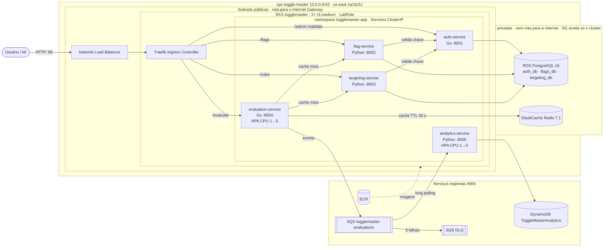

# ToggleMaster v2 — Infraestrutura

Repositório de infraestrutura do ToggleMaster (Tech Challenge — Fase 2, POSTECH
DevOps e Arquitetura Cloud): ambiente local com Docker Compose e manifestos
Kubernetes para o cluster local (kind) e para o Amazon EKS.

Os microsserviços ficam em repositórios próprios, cada um com o seu Dockerfile:
[auth-service](https://github.com/diego-diniz-ribeiro/auth-service) ·
[flag-service](https://github.com/diego-diniz-ribeiro/flag-service) ·
[targeting-service](https://github.com/diego-diniz-ribeiro/targeting-service) ·
[evaluation-service](https://github.com/diego-diniz-ribeiro/evaluation-service) ·
[analytics-service](https://github.com/diego-diniz-ribeiro/analytics-service)

## Arquitetura na AWS



**Segurança:** apenas o Load Balancer (porta 80) é público; os serviços são
ClusterIP; RDS e ElastiCache ficam em subnets privadas e aceitam conexões só do
Security Group do cluster;
senhas em Kubernetes Secrets gerados a partir de arquivo fora do Git;
credenciais AWS dos Pods vêm da LabRole do nó (IMDSv2), sem chaves no cluster.

## Estrutura

```text
docker-compose.yml        ambiente local (5 apps, 2 PostgreSQL, Redis, DynamoDB Local, ElasticMQ)
postgres/                 imagem PostgreSQL com o script que cria um banco e um usuário por serviço
k8s/base/                 manifestos comuns: Namespace, Deployments, Services, Ingress, HPAs
k8s/overlays/local/       cluster local (kind): data stores e emuladores dentro do cluster
k8s/overlays/aws/         EKS: imagens do ECR, endpoints dos serviços gerenciados, Job de init do RDS
k8s/scripts/              criação dos Secrets a partir de .env e bootstrap da chave do evaluation
loadtest/                 teste de carga (k6) e envio em massa para a SQS
```

## Como executar

### Local (Docker Compose / Podman)

```bash
cp .env.example .env      # preencher as senhas
docker compose up -d      # ou: podman compose up -d
```

O `evaluation-service` precisa de uma chave criada no `auth-service`
(`POST /admin/keys` com a `MASTER_KEY`), gravada em `SERVICE_API_KEY` no `.env`.

### Kubernetes (Kustomize)

```bash
kubectl apply -k k8s/overlays/local        # ou k8s/overlays/aws
k8s/scripts/create-secrets.sh local .env    # ou: aws .env.aws
k8s/scripts/bootstrap-service-key.sh .env   # ou: .env.aws
```

Os valores reais dos Secrets nunca são versionados: `.env` e `.env.*` estão no
`.gitignore`.
